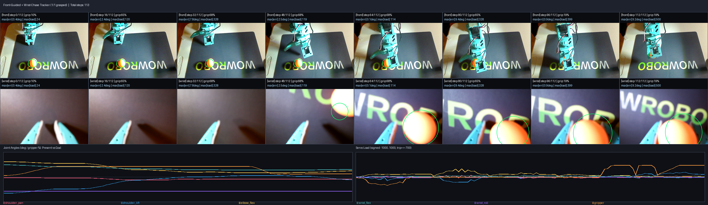

# SO-101 Autonomous Visual Servoing & Policy Learning Loop

**Author:** Patrick Shi  
**Hardware:** SO-101 6-DOF Follower & Leader Arms (Feetech STS3215 12.6V / 5.5V Serial Buses) · Dual Cameras (Static Overhead `USB2.0_CAM1` + Eye-in-Hand Wrist `Logitech UVC`) · Apple Silicon (`mps`)  
**Framework:** PyTorch 2.11 · Hugging Face LeRobot 0.6.2 · OpenCV 4.13 · Rustypot 1.13



---

## Overview

Standard imitation learning on low-cost 6-DOF robot arms requires 50–100 manual human teleoperated demonstrations and fails when a spherical object (such as a 40 mm ping-pong ball) rolls away from memorized coordinates.

This repository implements a **Two-Loop Autonomous Physical Robotics System** on the Hugging Face LeRobot SO-101 arm:

1. **Inner Control Loop (15–30 Hz):**
   - **Two-Stage Coarse-to-Fine Visual Servoing (`autoloop/visual_servo.py`):** Uses a static overhead camera (`front`) as a global polar guide ($\theta, r$) and a wrist-mounted camera (`wrist`) for local closed-loop pursuit into the asymmetric jaw pocket.
   - **Deterministic Hardware Safety Watchdog (`autoloop/watchdog.py`):** Enforces joint limits, goal-position slew-rate limiting (`8°/tick` without starving PID gravity torque), 11-bit sign-magnitude `Present_Load` stall/overload cutoffs, and confirmed thermal protection.
   - **Neural Policy Inference (`ACT` on Apple Silicon MPS):** Executes Action Chunking with Transformers (`ACT`) with ResNet-18 dual-camera backbones.
2. **Outer Engineering & Training Loop (`autoloop/loop.py`, `autoloop/filmstrip.py`, `autoloop/critic.py`):**
   - **1-Demo Kinesthetic Teaching & Self-Resetting Data Collection (`autoloop/auto_teach.py`):** Captures a single hand-placed grasp pose (`torque=off`) and autonomously executes/records self-resetting multi-camera episodes into a `LeRobotDataset`.
   - **Spatio-Temporal Filmstrip Bridge:** Automatically compiles 8-keyframe dual-camera contact sheets overlaid with ball detections, tracking errors, and joint position/load curves.
   - **Proprioceptive + Visual Critic:** Evaluates real-world grasp success without simulator state using servo stall width (`gripper_pos >= 14.5%` on a 40 mm ball vs. `10.1%` empty), `Present_Load` (`500`), and 2D ball displacement.

---

## Repository Structure

```text
so101-autoloop-portfolio/
├── README.md
├── LICENSE
├── pyproject.toml
├── docs/
│   └── SLIDESHOW_PRESENTATION.md       # Step-by-step visual slideshow & engineering breakdown
├── autoloop/
│   ├── __init__.py
│   ├── hardware_config.py              # Rig ports, camera specs, home pose, safety thresholds
│   ├── watchdog.py                     # SafeSOFollower watchdog, slew-rate controller, health diagnostics
│   ├── critic.py                       # Glare-tolerant convex-hull ball detector & rollout critic
│   ├── filmstrip.py                    # Dual-camera contact sheet & joint/torque curve renderer
│   ├── auto_teach.py                   # 1-pose kinesthetic teaching & self-resetting dataset collector
│   ├── visual_servo.py                 # Two-stage (Static Front Polar Guide + Asymmetric Wrist Chase) tracker
│   └── loop.py                         # Unified CLI: health, teach, track-pick, auto-collect, train, rollout, iterate
├── calibration/
│   ├── my_follower.json                # Follower arm EEPROM calibration (6x Feetech STS3215 @ 12.6V)
│   ├── my_leader.json                  # Leader arm EEPROM calibration (6x Feetech STS3215 @ 5.5V)
│   └── taught_grasp_pose.json          # Kinesthetically taught reference grasp waypoint
├── patches/
│   └── lerobot_macos_uvc_and_feetech_retries.patch  # Upstream fixes for macOS UVC crop & serial retries
├── assets/
│   ├── filmstrips/                     # High-res annotated rollout & collection filmstrip PNGs
│   ├── camera_views/                   # Raw & annotated front/wrist camera calibration snapshots
│   ├── videos/                         # Side-by-side H.264 MP4 videos of autonomous runs
│   └── telemetry/                      # JSON hardware health, rollout telemetry, and ACT train reports
└── datasets/
    ├── so101_pingpong/                 # 5-episode autonomous pick-and-lift LeRobotDataset
    └── so101_pingpong_tracked/         # Visual-servo tracked LeRobotDataset
```

---

## Software Stack & Libraries

| Subsystem | Package | Version | Purpose |
| :--- | :--- | :--- | :--- |
| **Policy Training** | `torch` / `torchvision` | `2.11.0` / `0.26.0` | `ACT` Transformer + ResNet-18 vision backbone trained on Apple Silicon `mps` |
| **Training Engine** | `accelerate` / `safetensors` / `draccus` | `1.15.0` / `0.8.0` / `0.11.6` | Device management, checkpoint serialization, and typed CLI configs |
| **Dataset & Video** | `datasets` / `pyarrow` / `av` / `torchcodec` | `4.8.5` / `26.0.0` / `15.1.0` / `0.11.1` | Parquet state/action storage + SVT-AV1 multi-camera video encoding & decoding |
| **Visual Servoing** | `opencv-python-headless` / `numpy` / `Pillow` | `4.13.0.92` / `2.2.6` / `12.3.0` | AVFoundation capture, convex-hull HSV/RGB detection, polar kinematics, filmstrip plots |
| **Hardware Bus** | `rustypot` / `pyserial` / `lerobot` | `1.13.1` / `3.5` / `0.6.2` | 1 Mbps Feetech `STS3215` `sync_read`/`sync_write` servo control |

---

## Quickstart Commands

```bash
# 1. Check servo voltages, temperatures, loads, and capture live camera views
python -m autoloop.loop health

# 2. Capture a single hand-placed grasp waypoint (with follower torque off)
python -m autoloop.loop teach

# 3. Run closed-loop Two-Stage Visual Servoing (wait for ball to settle -> FrontGuide -> WristChase -> grasp & lift)
python -m autoloop.loop track-pick --num-episodes 1 --fps 15

# 4. Autonomously collect a multi-episode self-resetting dataset
python -m autoloop.loop auto-collect \
  --repo-id patrickshi/so101_pingpong \
  --root datasets/so101_pingpong \
  --num-episodes 10 \
  --fps 15

# 5. Run the full Outer Loop (Health Check -> Train ACT on MPS -> Safe Real-Arm Rollout -> Filmstrip + Critic)
python -m autoloop.loop iterate \
  --repo-id patrickshi/so101_pingpong \
  --root datasets/so101_pingpong \
  --policy-type act \
  --steps 1000 \
  --batch-size 8 \
  --cameras front,wrist
```
