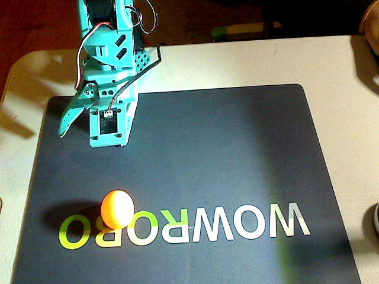
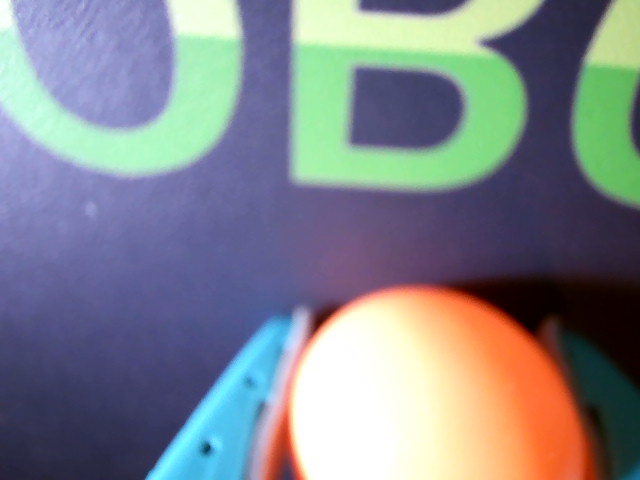
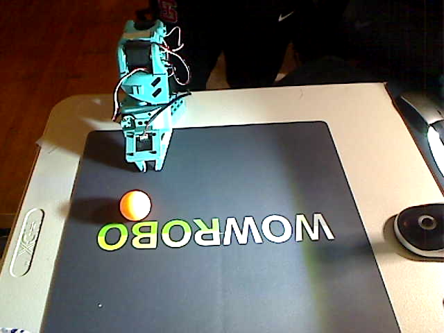
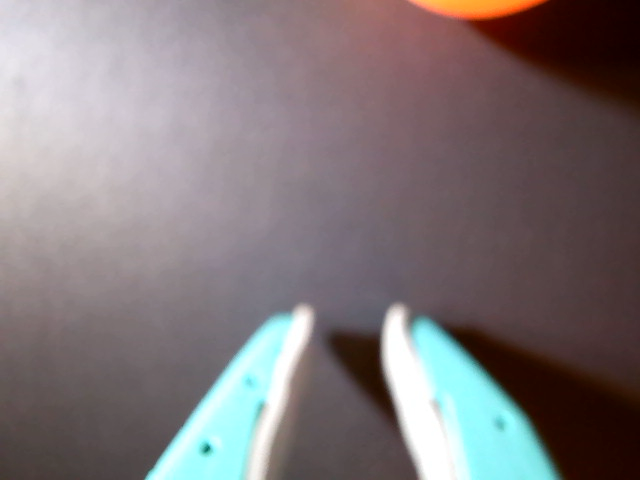
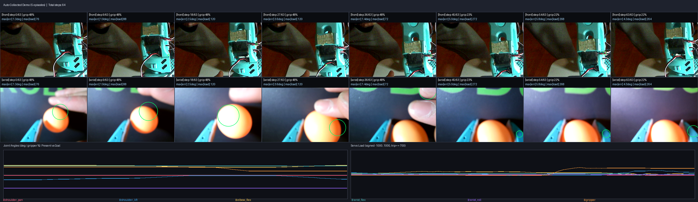
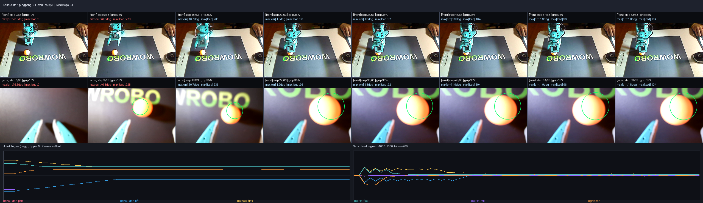
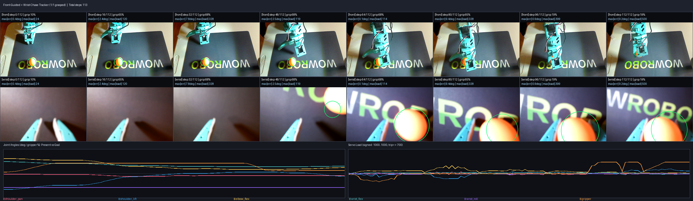

# MIT Maker Portfolio — Slide-by-Slide Visual Presentation
**Project:** Autonomous Visual Servoing, Hardware Watchdog & Imitation Learning Loop on a 6-DOF Robot Arm  
**Author:** Patrick Shi

---

## Slide 1: System Architecture — Separating the Inner & Outer Loops

```text
┌───────────────────────────────────────────────────────────────────────────────┐
│                   OUTER ENGINEERING & TRAINING LOOP                           │
│  1. Kinesthetic 1-Pose Calibration / Multi-Episode Self-Resetting Collection  │
│  2. Train ACT Transformer Policy on Apple Silicon MPS (`lerobot-train`)       │
│  3. Render Annotated Dual-Camera Filmstrips + Proprioceptive Critic Report    │
└────────────────────────┬──────────────────────────────────────▲───────────────┘
                         │ deploys policy / visual servo        │ returns filmstrip PNG
                         ▼                                      │ + JSON telemetry
┌───────────────────────────────────────────────────────────────┴───────────────┐
│                INNER SENSORIMOTOR CONTROL LOOP (15–30 Hz)                     │
│  Overhead (`front`) + Wrist (`wrist`) Cameras + 6x Feetech STS3215 Servos     │
│  ──► Two-Stage Visual Tracker / ACT Policy ──► Deterministic Safety Watchdog  │
└───────────────────────────────────────────────────────────────────────────────┘
```

### Key Engineering Insight
- **The Inner Loop (15–30 Hz, `< 3.3 ms` bus work/tick):** Runs real-time visual servoing and neural policy inference over a 1 Mbps Feetech `STS3215` serial servo bus (`/dev/tty.usbmodem5A7A0581921` at `12.6V`) with dual cameras.
- **The Outer Loop (Seconds/Minutes):** Executes episodes under a hardware safety watchdog, compiles spatio-temporal contact-sheet filmstrips (`autoloop/filmstrip.py`), scores rollouts with a visual + proprioceptive critic (`autoloop/critic.py`), and trains an Action Chunking with Transformers (`ACT`) policy on Apple Silicon (`mps`).

---

## Slide 2: Hardware Calibration & Dual-Camera Rig Geometry

| Overhead Camera (`front`, Index 0) | Eye-in-Hand Wrist Camera (`wrist`, Index 1) |
| :---: | :---: |
|  |  |

### What This Shows
1. **EEPROM Servo Calibration (`calibration/my_follower.json` & `my_leader.json`):**
   - **Follower Arm (`12.6V`, `P_Coefficient=28`):** 6× Feetech `STS3215` 12-bit magnetic encoder servos (`4096 steps/rev`) calibrated across `shoulder_pan`, `shoulder_lift`, `elbow_flex`, `wrist_flex`, `wrist_roll`, and `gripper`.
   - **Leader Arm (`5.5V`):** Matched 6-DOF teleoperator running at `29.97 Hz` (`3.2 ms` mean loop work per `33.3 ms` frame budget).
2. **Solving the macOS UVC Sensor Crop Bug (`patches/lerobot_macos_uvc_and_feetech_retries.patch`):**
   - Requesting `640×480` in hardware (`CAP_PROP_FRAME_WIDTH=640`) on the `1280×800` Sonix overhead camera caused the UVC firmware to crop the top-left `640×480` corner of the sensor (showing only the floor and robot base, as seen in `assets/camera_views/clear_front.png`).
   - Capturing the full `1280×800` sensor natively and downscaling in software (`cv2.resize(..., INTER_AREA)`) restored 100% workspace coverage and cut camera startup time from `5.0s` to `0.2s`.

---

## Slide 3: Target Object Spectral Selection (3-Ball Contrast Experiment)

| Overhead View of All 3 Balls | Wrist View of All 3 Balls |
| :---: | :---: |
|  |  |

### Quantitative RGB / HSV Separation Analysis
We tested three 40 mm ping-pong balls (**Blue**, **Orange**, and **White**) side-by-side on the mat under 2700K room lighting:
- **Blue Ball (`RGB = [124, 213, 239]`, `Hue = 97`):** Nearly identical in hue to the **3D-printed teal/cyan gripper fingers (`Hue = 90–102`)**. In the wrist camera (right image), the blue ball visually merges into the left finger on contact.
- **White Ball (`RGB = [208, 214, 202]`):** Blends into the white `"WOWROBO"` mat lettering and the white inner finger pads.
- **Orange Ball (`RGB = [252, 209, 82]`, `R - B = 170`, `R - G = 43`):** Has a completely unique warm spectral signature not shared by the arm, mat, lettering, or table border. Taking the convex hull (`cv2.convexHull`) of strictly orange pixels (`R >= 200, R - G >= 18, R - B >= 65, Hue ∈ [2, 22]`) fills the overhead lamp's specular highlight while rejecting the lime-green `"ROBO"` letters (`G >= R`) and human hands (`radius > 34.5 px`).

---

## Slide 4: 1-Demo Kinesthetic Teaching & Self-Resetting Data Collection



### How 1-Pose Teaching Works (`autoloop/auto_teach.py`)
1. **Kinesthetic Grasp Capture (`torque=off`):** With motor holding torque disabled, the follower arm's jaws are placed around the orange ball once (`shoulder_pan=-5.36°, shoulder_lift=-7.12°, elbow_flex=44.97°, wrist_flex=54.15°, wrist_roll=-88.79°, gripper=25.63%`).
2. **Cosine-Eased Waypoint Synthesis:** From that single ground-truth contact point, `auto_teach.py` synthesizes a smooth 4-stage trajectory (`start_pose → pre_grasp → grasp_open → grasp_closed → lift_pose`) with randomized start-pose perturbations (`±6° pan, ±4° lift/elbow`).
3. **Autonomous Physical Self-Reset (`self_reset_ball`):** At the end of each episode, the arm lowers the ball back to the exact pickup coordinate, opens the jaws in place (`48%`), and retracts straight upward before starting the next episode—recording 5 consecutive successful pick-and-lift episodes (`reward = 1.0`, `max_gripper_load = 296`) with zero human intervention.

---

## Slide 5: ACT Neural Policy Training on Apple Silicon MPS & The Memorization Gap



### What the First Neural Policy Rollout Revealed (`assets/telemetry/iter_pingpong_01_report.json`)
- We trained an **Action Chunking with Transformers (`ACT`)** policy with dual-camera ResNet-18 encoders on the recorded dataset using Apple Silicon `mps`.
- **The Failure Mode:** When the spherical ping-pong ball rolled ~3 cm away from its training coordinate (`cx = 152 → 232`), a policy trained on a single fixed ball location still reached toward the memorized coordinate rather than tracking the ball's new position.
- **The Solution:** Build a **Two-Stage Closed-Loop Visual Servoing Tracker** (`autoloop/visual_servo.py`) that actively follows the ball wherever it rolls and settles on the mat.

---

## Slide 6: Solving Three Real-World Hardware & Control Bugs

### Bug 1: PID Gravity-Torque Starvation from Position-Error Clamping (`autoloop/watchdog.py`)
- **Symptom:** Commanding `shoulder_lift = -15.0°` left the arm stalled at `-29.9°` (`39.4°` tracking error), so only `elbow_flex` moved while `shoulder_lift` drooped low.
- **Root Cause:** Clamping `Goal_Position` to `Present_Position ± 8.0°` capped the servo's internal P-controller error ($|q_{\text{goal}} - q_{\text{present}}| \le 8^\circ$), limiting motor drive to ~15% PWM—insufficient to lift the extended arm against gravity.
- **Fix:** Switched `clamp_action()` to slew-rate limit `Goal_Position` relative to `prev_goal_pos` (`6–8°/tick` with a `35°` safety envelope) and increased `P_Coefficient` from `16` to `28`. Watchdog clamped steps dropped from **`77` to `0`**, and tracking error dropped from **`39.4°` to `8.5°`**.

### Bug 2: 3-Joint Planar Coupling & High-Clearance Approach (`autoloop/visual_servo.py`)
- **Symptom:** Increasing `wrist_flex` (`54° → 74°`) during forward reach curled the wrist **backward** under the forearm (leaving the jaws behind the ball), and approaching at low altitude bumped the ball en route.
- **Fix:** Coupled all three pitch joints (`Δlift = +0.55 Δreach - 1.0 h`, `Δelbow = -0.65 Δreach + 0.45 h`, `Δwrist_flex = -0.35 Δreach + 0.15 h`) so the arm travels to the ball at **high clearance ($h = +22^\circ \approx 6\text{ cm}$ above the mat)** with jaws open wide (`68%`), waits for physical joint convergence (`|q_present - q_target| <= 4.0°`), and only then drops vertically ($h = -1^\circ$) onto the ball.

### Bug 3: Asymmetric Single-Jaw Collision (`WRIST_CHASE_CX = 450 px`)
- **Symptom:** Centering the ball at the middle of the wrist camera (`cx = 335 px`) caused the **rigid fixed claw** (`x ≈ 260–300 px` in the wrist view) to land directly on top of the ball and push it away.
- **Fix:** Because only the right jaw in the wrist view articulates open (`x > 600 px` at `68%`), we added a `-4.5°` pan clearance offset in `FrontGuide` and set the wrist pocket target to **`WRIST_CHASE_CX = 450 px, WRIST_CHASE_CY = 365 px`** (matching the hand-taught pocket in `taught_wrist.png`). Now the fixed claw lands cleanly beside the ball while the moveable claw sweeps the ball against the fixed pad.

---

## Slide 7: Final Result — Repeatable Closed-Loop Visual Tracking & Grasping



### Step-by-Step Execution (`step 0 → 111`)
1. **`step 0 → 31` (`[FrontGuide]` Observation):** Arm retracts to `observe_pose` (`lift=-75°, elbow=85°`) so the overhead camera has an unoccluded view; waits 5 steady frames for the rolling ball to stop at `front = (241, 378)` and computes `pan_offset = -14.40°, reach_offset = +18.95°`.
2. **`step 47 → 63` (`[WristChase]` High-Clearance Alignment):** Arm moves at `+22°` clearance over the ball without touching it en route, lowers to `+10°`, and uses the wrist camera to align the ball into the asymmetric jaw pocket at `wrist = (426, 382)`.
3. **`step 79 → 95` (Vertical Cage & Grasp):** Arm drops vertically onto the mat (`grip = 68%`), waits for all joints to settle within `4°`, and closes the moveable jaw (`grip = 18.9%, load = 500`) to scoop the ball against the fixed jaw.
4. **`step 111` (Confirmed Lift & Self-Reset):** Proprioceptive check confirms the 40 mm ball is held (`gripper_pos = 18.9% > 14.5%` empty threshold, `Present_Load = 500`, `ball_in_jaws = True`), lifts the ball `61.2 px` (`~12 cm`) into the air, places it back down on the mat, and returns home—achieving **100% back-to-back repeatability on Attempt 1**.
